<p align="center">
  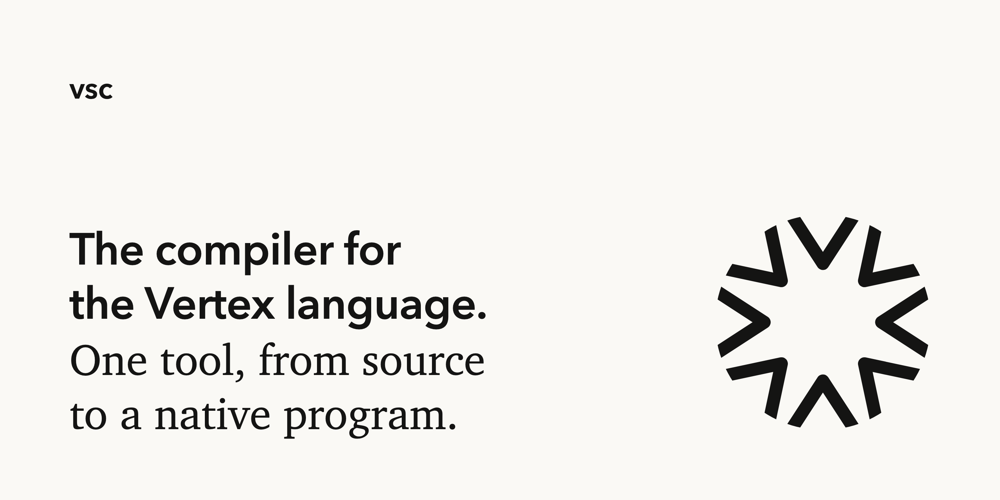
</p>

`vsc` compiles [Vertex](https://github.com/vertex-language/vertex-language) to
native programs. One tool reads your source, checks it, and writes the
executable, with no separate compiler, assembler or linker to install.

[Language](https://github.com/vertex-language/vertex-language) ·
[Specification](docs/vertex_spec.md) ·
[Command line](docs/cli.md) ·
[Editor support](https://github.com/vertex-language/vscode-vertex)

## Getting started

`vsc` is written in Go 1.25 and builds from a set of sibling checkouts:

```
mkdir vertex && cd vertex
for repo in vsc vcx ir asm air amd64 arm64 i386 amdgpu ptx elf macho pe; do
    git clone https://github.com/vertex-language/$repo
done
cd vsc/cmd && go build -o ~/bin/vsc ./vsc
```

A program can be a single file:

```
vsc run main.vs
vsc build -o main main.vs
```

## The language

### Values

A method says how it holds its receiver: `borrowing` to read, `inout` to change.

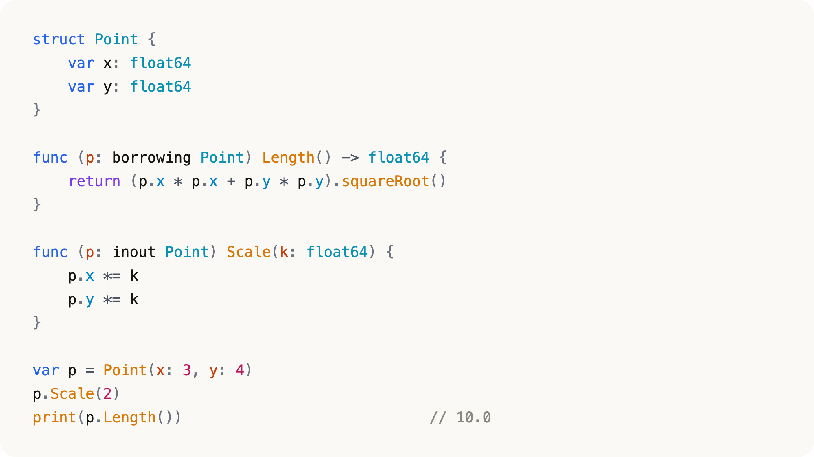

### Collections

Arrays and dictionaries are built in, with the transformations you expect.

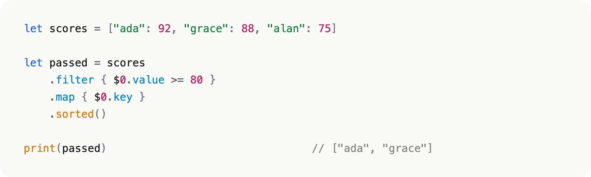

### Enums

Enums carry data and are matched exhaustively.

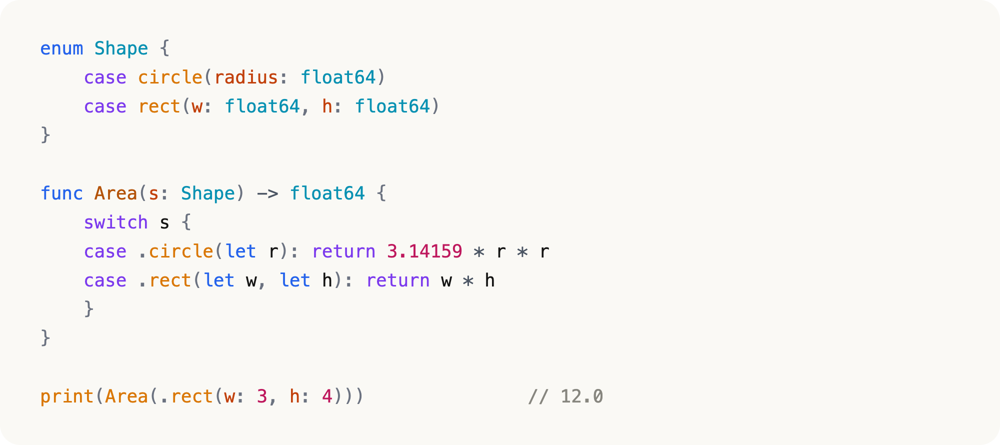

### Protocols and generics

Protocols describe behavior, and generics work over anything that has it.

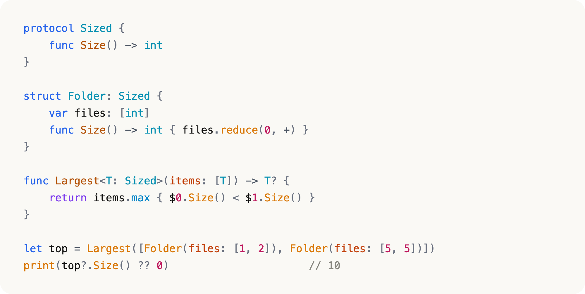

### Errors

Functions say when they can fail, and callers decide what to do about it.

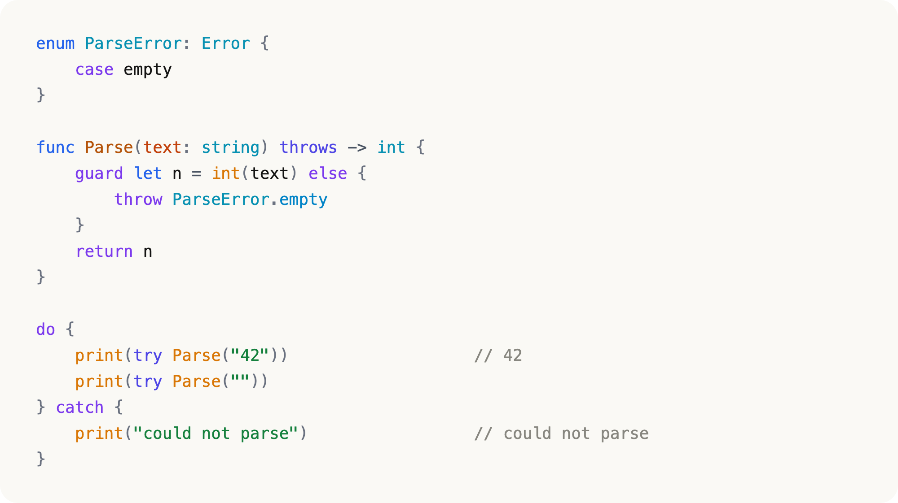

### Concurrency

Tasks run side by side with `async let`, and actors keep their state to themselves.

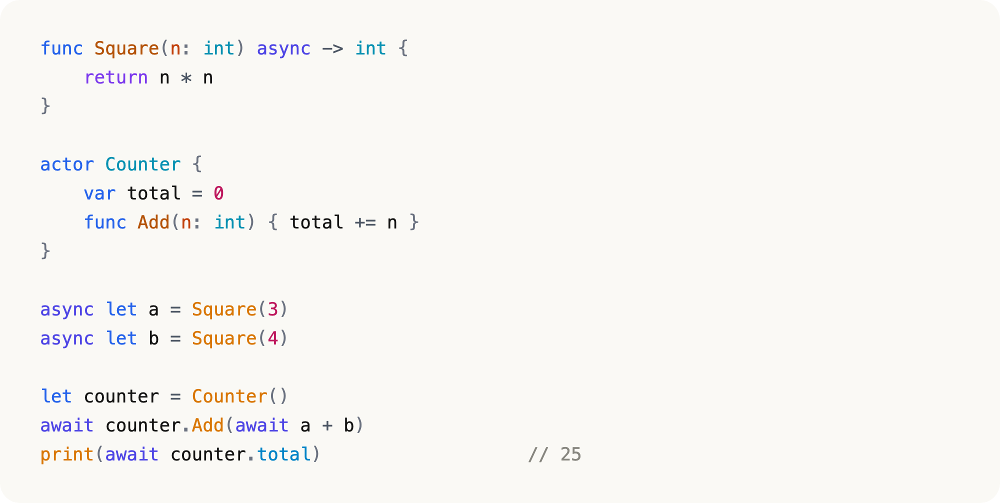

## Standard packages

Vertex comes with packages for most of what a program needs. Each is imported by
a short path, such as `import "net/http"`, and the first build that uses it
fetches it.

| | |
| :--- | :--- |
| Core | [`io`](https://github.com/vertex-language/io) · [`fs`](https://github.com/vertex-language/fs) · [`os`](https://github.com/vertex-language/os) · [`time`](https://github.com/vertex-language/time) · [`log`](https://github.com/vertex-language/log) · [`sync`](https://github.com/vertex-language/sync) · [`cli`](https://github.com/vertex-language/cli) · [`math`](https://github.com/vertex-language/math) · [`unicode`](https://github.com/vertex-language/unicode) · [`text`](https://github.com/vertex-language/text) |
| Data | [`encoding`](https://github.com/vertex-language/encoding) · [`compress`](https://github.com/vertex-language/compress) · [`archive`](https://github.com/vertex-language/archive) · [`hash`](https://github.com/vertex-language/hash) · [`crypto`](https://github.com/vertex-language/crypto) · [`db`](https://github.com/vertex-language/db) |
| Networking | [`net`](https://github.com/vertex-language/net) · [`remote`](https://github.com/vertex-language/remote) |
| Interfaces | [`ui`](https://github.com/vertex-language/ui) · [`web`](https://github.com/vertex-language/web) · [`js`](https://github.com/vertex-language/js) · [`terminal`](https://github.com/vertex-language/terminal) · [`icons`](https://github.com/vertex-language/icons) |
| Graphics and sound | [`image`](https://github.com/vertex-language/image) · [`media`](https://github.com/vertex-language/media) · [`render`](https://github.com/vertex-language/render) · [`mesh`](https://github.com/vertex-language/mesh) · [`anim`](https://github.com/vertex-language/anim) · [`shader`](https://github.com/vertex-language/shader) · [`gles`](https://github.com/vertex-language/gles) · [`gpu`](https://github.com/vertex-language/gpu) |
| Simulation and games | [`entity`](https://github.com/vertex-language/entity) · [`physics`](https://github.com/vertex-language/physics) · [`behavior`](https://github.com/vertex-language/behavior) · [`nav`](https://github.com/vertex-language/nav) · [`humanoid`](https://github.com/vertex-language/humanoid) · [`flora`](https://github.com/vertex-language/flora) |
| Machine learning | [`tensor`](https://github.com/vertex-language/tensor) · [`nn`](https://github.com/vertex-language/nn) · [`model`](https://github.com/vertex-language/model) · [`llm`](https://github.com/vertex-language/llm) · [`tts`](https://github.com/vertex-language/tts) |
| Virtualization | [`vm`](https://github.com/vertex-language/vm) · [`vmimage`](https://github.com/vertex-language/vmimage) · [`container`](https://github.com/vertex-language/container) · [`oci`](https://github.com/vertex-language/oci) |

### Files and hashing

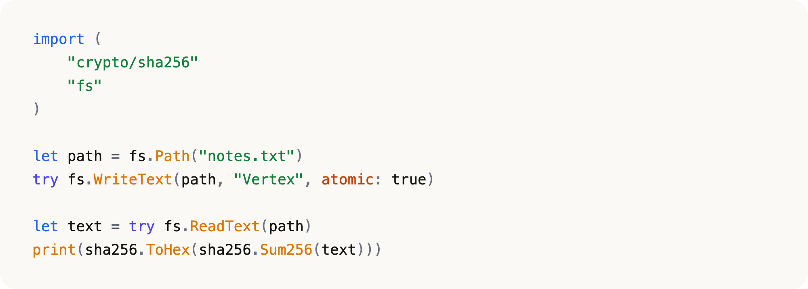

### Web servers

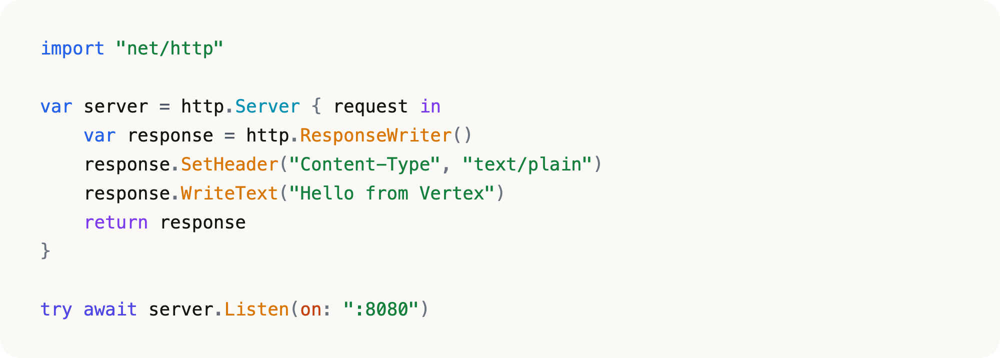

### Interfaces

Markup is an expression, and a `.vsx` file puts it beside the code it belongs to.

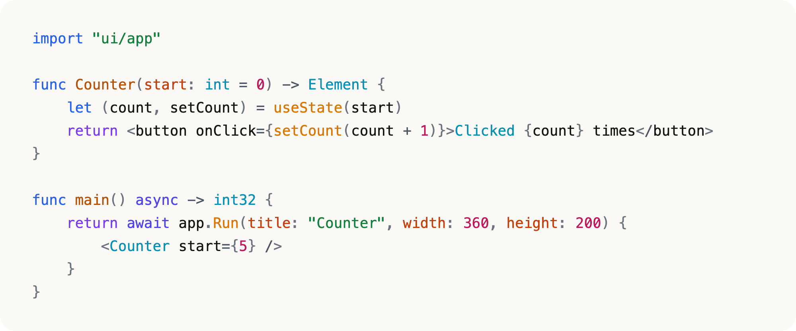

### JavaScript

A JavaScript engine you can embed in a program.

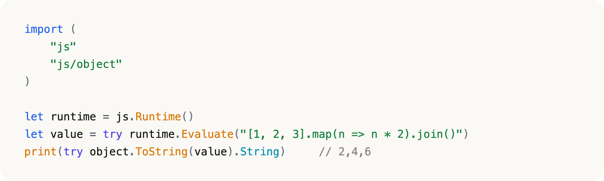

### Physics

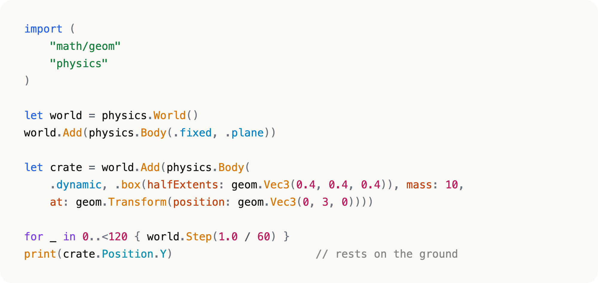

### Language models

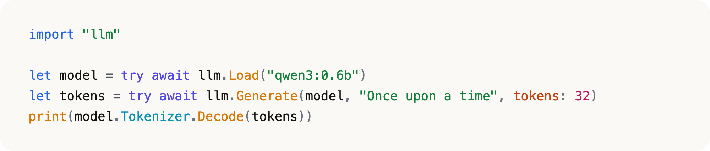

## Writing packages

A package is a folder, and a module is a folder with a `vs.mod`. Nothing lists
the files. Programs live in `cmd/` and run by name.

```
geo/
├── vs.mod
├── shape/
│   ├── shape.vs
│   └── shape.cpp
└── cmd/
    └── area/
        └── main.vs
```

```
module github.com/you/geo

vertex 0.9
```

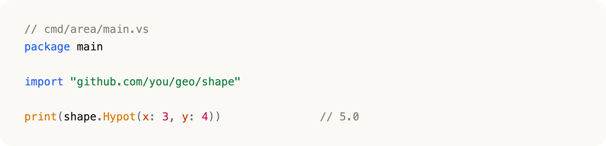

```
vsc run area
```

Dependencies are fetched on the first build that needs them, and their hashes
are recorded in `vs.sum`.

## Native code

A package can carry C++ beside its Vertex. `vsc` compiles it with
[vcx](https://github.com/vertex-language/vcx), reads its exports, and gives them
to the package as ordinary declarations. There are no headers or bindings to
write.

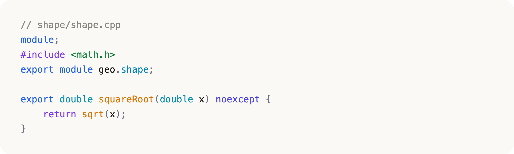

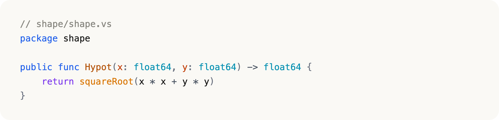

## Commands

| | |
| :--- | :--- |
| `vsc run` | Build a program and run it |
| `vsc build` | Compile and link |
| `vsc install` | Build programs into `~/.vertex/bin` |
| `vsc check` | Parse and type-check |
| `vsc doc` | Write a package's documentation |
| `vsc env` | Print the target, SDK and package cache |
| `vsc ast`, `vsc tokens` | Print the syntax tree or token stream |

## Targets

| | |
| :--- | :--- |
| `aarch64-macos` | Mach-O |
| `aarch64-android` | ELF |
| `x86_64-linux` | ELF |
| `x86_64-windows` | PE/COFF |

Build for another target with `-target`. A target's system libraries must be
available to link against, and `async` code does not build for Windows yet.

## How it works

Source is parsed and checked, lowered through an ownership-checked IR, and then
to VIR, the machine IR. VIR becomes machine code, a package's C++ joins as object
files, and `vsc`'s own linker writes the program. `vsc` is also a Go library: see
[Internals](docs/internals.md).

## Testing

```
go test ./...
cd build && go test ./...
```

`tests/` is a ladder of more than 450 small programs, climbing from an empty one
up. Each is built and run, and its output is compared with a reference
compiler's.

## Documentation

- [The language](docs/language.md)
- [Specification](docs/vertex_spec.md)
- [Packages](docs/packages.md)
- [Native C++](docs/native.md)
- [Kernels](docs/kernels.md)
- [Markup (VSX)](docs/vsx.md) and [styles (VSS)](docs/vss.md)
- [Command line](docs/cli.md)
- [Internals](docs/internals.md)

## Repositories

| | |
| :--- | :--- |
| Language | [`vertex-language`](https://github.com/vertex-language/vertex-language) · [`website`](https://github.com/vertex-language/website) · [`vscode-vertex`](https://github.com/vertex-language/vscode-vertex) |
| Compilers | [`vsc`](https://github.com/vertex-language/vsc) · [`vcx`](https://github.com/vertex-language/vcx) |
| Code generation | [`ir`](https://github.com/vertex-language/ir) · [`asm`](https://github.com/vertex-language/asm) · [`arm64`](https://github.com/vertex-language/arm64) · [`amd64`](https://github.com/vertex-language/amd64) · [`i386`](https://github.com/vertex-language/i386) · [`air`](https://github.com/vertex-language/air) · [`amdgpu`](https://github.com/vertex-language/amdgpu) · [`ptx`](https://github.com/vertex-language/ptx) · [`wasm`](https://github.com/vertex-language/wasm) |
| Linking | [`elf`](https://github.com/vertex-language/elf) · [`macho`](https://github.com/vertex-language/macho) · [`pe`](https://github.com/vertex-language/pe) |
| Packaging | [`macpkg`](https://github.com/vertex-language/macpkg) · [`winpkg`](https://github.com/vertex-language/winpkg) · [`androidpkg`](https://github.com/vertex-language/androidpkg) |
| Programs | [`nitro-velocity`](https://github.com/vertex-language/nitro-velocity) |

## License

[MIT](LICENSE)
